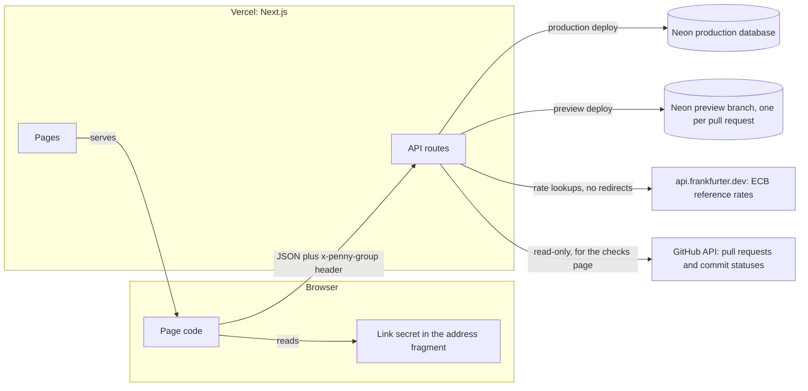
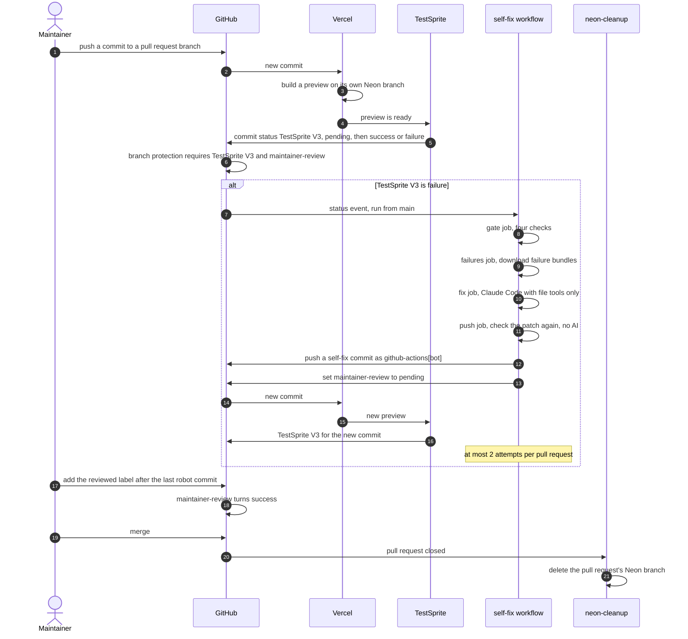
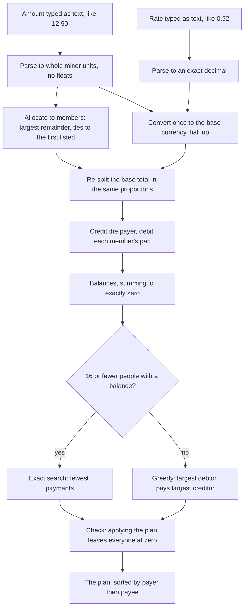

# Architecture

Penny is two packages in one repository. `@penny/core` is the money engine: pure functions on whole numbers, with no network and no database. `@penny/web` is a Next.js app that stores groups in Postgres and calls the engine for every amount it saves or shows. The browser runs the same engine to preview a split, so the preview and the saved result come from one piece of code.

This file is the written interface: the three diagrams, the data model, the API and the rules that bind them. The product behaviour, screen by screen, is in [docs/prd.md](docs/prd.md).

## System

This diagram shows where each piece runs and which way data moves. The group link's secret stays in the address fragment after `#`, which browsers never send in a request, and the page copies it into a header for the API.

Notes that the picture leaves out:

- Every API route runs for at most 10 seconds, and every database statement has its own time limit.
- Rate limits are rows in Postgres, not memory, so they hold across serverless instances.
- The rate and the pull request list are cached in Postgres (`fx_cache`, `checks_snapshot`), so many visitors cost the upstream one call per window.
- Pages and routes send a content security policy, `Referrer-Policy: no-referrer` and `noindex` on group pages. The details are in the [threat model](docs/security/threat-model.md).

## The pull request loop

This diagram shows what happens to one pull request, from push to merge, including the path where TestSprite fails and the self-fix workflow pushes a repair. The merge needs two commit statuses, `TestSprite V3` and `maintainer-review`, and GitHub enforces both.

- `maintainer-review` is success at once for a pull request with no robot commit. It stays pending on one with a robot commit until the maintainer adds the `reviewed` label after the last robot commit.
- `TestSprite V3` is pinned to TestSprite's GitHub App and `maintainer-review` to GitHub Actions in the branch rule, so a job that borrows a name cannot satisfy either check.
- The full rules, the secrets each job holds and what the loop does not defend against are in [docs/security/self-fix.md](docs/security/self-fix.md).

## The money path

This diagram shows how a typed amount becomes balances and a settle-up plan. Nothing in it is a floating-point number, and each step that rounds names its rule.

- An expense in the base currency skips the rate and the conversion. A rate on a base-currency expense is refused rather than ignored.
- A conversion that rounds to zero is refused, and so is one that passes 10,000,000,000.00 in a two-decimal currency (10^12 minor units).
- A plan that fails the check is an error, not an answer.

## Data model

All tables are in [packages/web/src/db/schema.ts](packages/web/src/db/schema.ts). The migrations are in [packages/web/drizzle](packages/web/drizzle), and the build stops if any of them was skipped.

| Table | What it holds |
| --- | --- |
| `groups` | One row per group: name, base currency, a `version` that moves on every ledger write, and `token_hash`, the SHA-256 of the link token. The token itself is never stored. |
| `members` | A group's people, in the order added. Removing a member sets `removed_at` and keeps their history. Live names are unique per group after Unicode normalisation and lower-casing. |
| `expenses` | One row per expense: amount in minor units, currency, an exact rate (`rate_units` and `rate_scale`), who paid, the split mode, a `version` for edits, `deleted_at`, and a `client_id` that is unique per group so a retry cannot add it twice. |
| `expense_parts` | One row per member in a split. The weight is 1 for an equal split, the share count for shares, and the minor units for exact amounts. |
| `payments` | One row per recorded payment: from, to, amount, currency, rate, `deleted_at` for an undo, and a `client_id` unique per group. |
| `events` | The append-only log of every change. Database triggers refuse any update, delete or truncate. Balances equal a replay of this log, and a test proves it after random operations. |
| `checks_snapshot` | A single row holding the last good read of GitHub for the checks page, shared by every instance. |
| `fx_cache` | The latest rate per currency pair, kept as the decimal text that was accepted. |
| `rate_limits` | One counter per bucket, key and one-minute window. The key is a group id or an HMAC of the client network, never an address. |
| `server_keys` | A single row holding the key those HMACs use. |

Every member reference is a composite key on group and member, so a row cannot name a member of another group. The database also repeats the app's bounds as `CHECK` constraints: three capital letters for a currency, amounts from 1 to 10^12, a positive rate with a scale of at most 10.

## API

The routes are in [packages/web/src/app/api](packages/web/src/app/api). The table of methods, limits and error codes is in the [README](README.md#api). Every group route takes the link secret in the `x-penny-group` header, every body is JSON with a stated schema that rejects unknown fields, and every error body is `{"error":{"code":"..."}}` with no detail.

## Invariants

The rules that bind the pieces together are numbered C1 to C41 in the [threat model](docs/security/threat-model.md). They fall into these groups:

| Group | Numbers | What they cover |
| --- | --- | --- |
| Tenancy and the link | C1 to C6 | One function turns a token into a group, 128-bit tokens, only a hash stored, no id outside the group is trusted, exact request schemas. |
| Money | C7 to C18 | One parser for amounts and rates, one currency table, splits that add up, balances that sum to zero, retry-safe writes, version checks, an append-only log. |
| Upstream calls | C19 to C24 | One fixed rate source with no redirects, a checks page that cannot be told a check passed by a look-alike. |
| Rendering, limits and errors | C25 to C28 | Text is only ever text, limits hold across instances, no test-only door in production, errors reveal nothing. |
| Build, preview and CI | C29 to C37 | Previews hold synthetic data, the self-fix agent holds no secret and cannot push, a person merges every robot fix. |
| Link reset | C38 | A lost answer never leaves a group without a working link. |
| Later additions | C39 to C41 | One press is one payment, migrations cannot be skipped, stored currency codes stay readable. |
