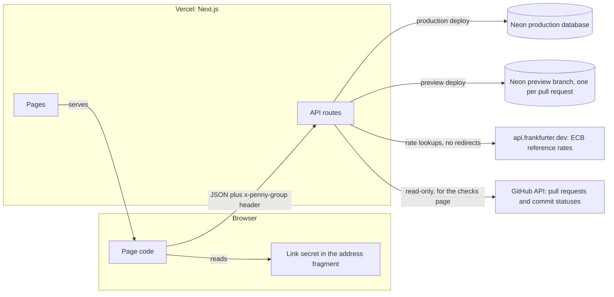
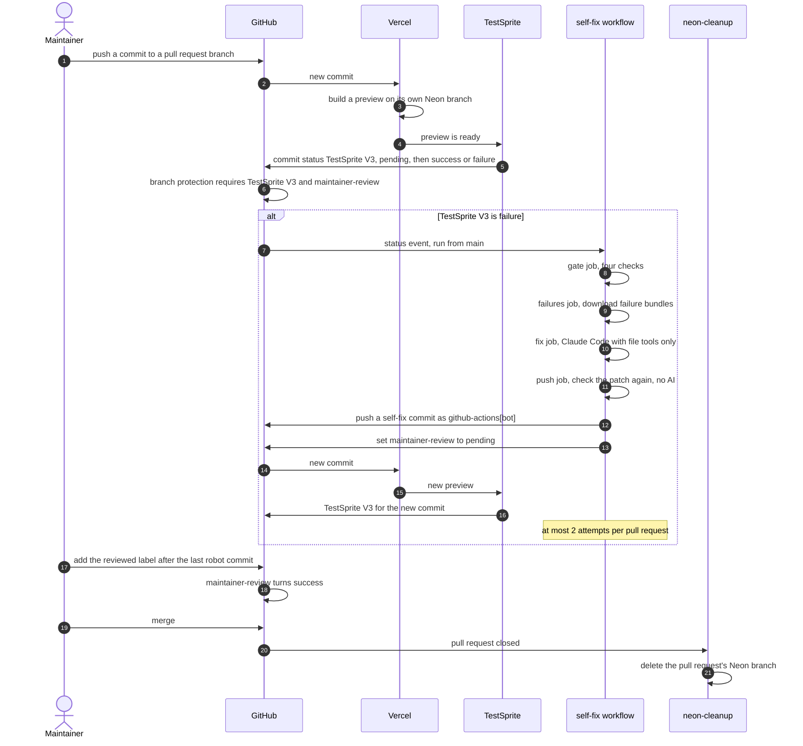
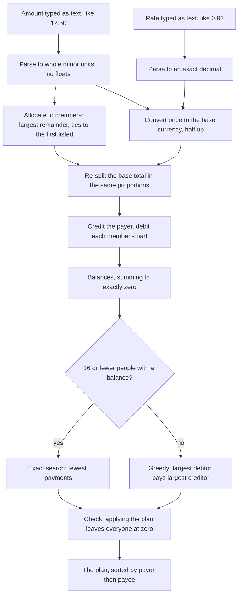

# Penny

Penny is an English word for the smallest coin; here it means splitting shared costs to the last one.

**Split shared costs to the penny.** Add what everyone paid. Penny works out the fewest payments to settle up, exact to the last cent.

[Live app](https://penny-self.vercel.app) · [Docs](https://penny-self.vercel.app/docs) · [How it is tested](https://penny-self.vercel.app/checks) · [The red-then-green PR](https://github.com/ramakrishnanhulk20/penny/pull/10)

## Every change is tested by TestSprite, and the merge waits for it

Pull request [#10](https://github.com/ramakrishnanhulk20/penny/pull/10) plants a one-line bug on purpose: the leftover cent of a split goes to the last person listed instead of the first, so 100.00 split three ways comes out as 33.33, 33.33 and 33.34. All times are UTC, 20 October 2026.

- **05:02** The bug is pushed and the pull request opens.
- **05:23** Vercel's preview is live and TestSprite queues its 21 browser tests against it.
- **05:27:08** TestSprite finishes its 21 browser tests on that preview and posts `TestSprite V3: failure`, "18/21 passed, 3 failed". The branch rule requires that check, so GitHub will not merge.
- **05:27:09** The [self-fix run](https://github.com/ramakrishnanhulk20/penny/actions/runs/39374963904) starts. Four jobs: gate, failures, fix, push. Claude Code reads the failure details with file tools only: 8 turns, about 9 US cents.
- **05:28:29** The push job finishes, 81 seconds after the red. Its commit, from `github-actions[bot]`, changes one line in `packages/core/src/allocate.ts` and undoes the planted flip.
- **05:31:52** TestSprite tests the new preview: "All 21 tests passed". Red to green took 4 minutes 44 seconds, with no person involved.
- **05:48:49** The maintainer reads the one-line change and merges.

The `maintainer-review` gate did not exist yet; it arrived in PR #11. From then on a pull request that carries a robot commit also waits for the maintainer to add a `reviewed` label. The full rules, the secrets each job holds and what the loop does not defend against are in [docs/security/self-fix.md](docs/security/self-fix.md).

## Where each judging line shows

| Judging line | Where to see it |
| --- | --- |
| Project quality: does the live app work well | The [live app](https://penny-self.vercel.app) and [the two-minute judge path](#the-two-minute-judge-path). Every number on every screen, the home page's animation included, comes from the money engine. |
| Coverage breadth | 24 browser tests across groups, splitting, currency, corrections and settling ([the list](#what-the-suite-covers)), 16 [API tests](#testsprite-16-api-tests-after-every-merge) that call the live API after every merge, plus unit, property and database tests in three packages. |
| Assertion depth | The browser tests assert exact values ("33.34", "155.74 EUR", "3 payments settle 7 expenses."), not that a page loaded. The planted bug in PR #10 moved one cent and three of them failed. The money engine's tests kill 91.29 percent of StrykerJS mutants (measured 20 October 2026 by a clean clone). A [planted-bug study](#planted-bug-study): 8 one-change bugs, 5 caught by the first 21 tests, all 8 after three tests aimed at the misses were added. The API tests compare whole answers, exact money strings and exact error bodies, and each one failed when a single expected value in it was changed. |
| Scenario design | Each browser test starts from the home page with its own fresh group and fixed data, so tests never share state and a failure points at one behaviour. |
| Fires on every pull request | Every pull request since the suite existed carries a `TestSprite V3` status; [/checks](https://penny-self.vercel.app/checks) lists them with their counts. |
| Holds the merge | `main` requires `TestSprite V3`, pinned to TestSprite's app, for administrators too. PR #10 could not merge while it was red. |
| Innovation | The self-fixing loop (red to green in 4 minutes 44 seconds with no person involved), the `maintainer-review` gate that keeps a person on every robot fix, and a [/checks](https://penny-self.vercel.app/checks) page that shows inside the product which verdict let the running build ship. |

## Live deployments

| Where | Address | Database | Lifetime |
| --- | --- | --- | --- |
| Production | https://penny-self.vercel.app | Neon `penny-prod` | Deploys from `main` |
| Pull request preview | `https://penny-git-<branch>-rams-projects-86cea8eb.vercel.app` | Its own Neon branch, `preview/<branch>`, copied from `penny-preview` (synthetic data only) | The `neon-cleanup` workflow deletes the branch when the pull request closes |

The branch rule on `main` requires a pull request, applies to administrators, and blocks force pushes and deletion. Two commit statuses must be green before GitHub allows a merge:

| Required check | Posted by | Pinned to | Meaning |
| --- | --- | --- | --- |
| `TestSprite V3` | TestSprite's GitHub App | App id 2756476 | The browser tests (24 today) passed on this pull request's preview |
| `maintainer-review` | The `maintainer-review` workflow | GitHub Actions (app id 15368) | Green at once if no robot commit exists; otherwise pending until the `reviewed` label is added after the last one |

A job that borrows either name cannot satisfy the rule, because each check is pinned to its source. The `ci` workflow (typecheck, lint, unit tests) also runs on every pull request, but it is not a required check.

## Overview

Four friends go to Lisbon. One pays the flights in euros, another the apartment, one a surf lesson in dollars. Splitting 100.00 three ways leaves a cent that belongs to nobody. By the end there are seven receipts and a tangle of who owes whom.

Penny turns that into a short list. You add what each person paid. Penny splits every expense down to the smallest unit of its currency, converts foreign ones once at a rate you can see and change, and works out the fewest payments that bring everyone to exactly zero. There is no account to make: a group is opened by its private link.

| | Penny | A spreadsheet | A typical splitting app |
| --- | --- | --- | --- |
| Exact to the cent, with a stated rounding rule | Yes. Whole minor units, largest remainder, leftover to the first listed | Only if you write the rounding yourself | Varies, and the rule is often not stated |
| Several currencies, with a stated rate | Yes. One conversion per expense, half up, at a rate you can read and edit | You look up and paste the rate | Varies |
| Fewest payments | Yes, the true minimum for up to 16 people with a balance, greedy beyond | By hand | Some simplify debts, often with a shortcut |
| No account | Yes. A private link opens the group | Usually needs an account to share | Usually needs a sign-up |
| Tested on every change to the app | Yes. 24 browser tests and the unit tests, and the merge waits for the browser tests | No | Not shown to users |

The last two columns describe the usual case, not a review of any one product.

## Features

Each feature lists the rule that makes it exact.

**Split**
- Three ways to split an expense: equally, by shares (a whole number from 1 to 1000, or 0 to leave someone out), or by exact amounts that must add up to the total. A live preview shows each person's share before you save.
- Rule: every amount is stored as a whole number of the currency's smallest unit (JPY has none, USD has 2, KWD has 3, from the ISO 4217 table). Leftover units go one each to the largest remainders, ties to whoever is listed first, so the parts always add up to the expense.

**Convert**
- An expense can be in any ISO 4217 currency. For a foreign one, when the European Central Bank publishes a rate for that pair, the rate is prefilled with its reference rate for the latest day, labelled with its date; otherwise you type it. You can always type your own.
- Rule: one conversion per expense, rounded half up, in exact integer arithmetic. The base-currency parts are the foreign parts re-split over the converted total, so they add up too. A rate has at most 10 decimals and lies between 0 and 1,000,000.

**Settle**
- Balances per member, with a total that is always exactly 0.00. The settle-up list shows the fewest payments, each with a "Mark as paid" button, and a proof line such as "3 payments settle 7 expenses."
- Rule: with up to 16 people who have a balance, the plan has the fewest payments possible (an exact search). Above 16 it uses the greedy rule, which needs fewer payments than there are people with a balance, though not always the fewest. Either way the plan is checked before it is shown: applying it must leave everyone at exactly zero.

**Share**
- No accounts. A group is opened by `/g#<secret>`. "Copy link" copies it, and "Reset link" makes a new one and kills the old. "You are:" is remembered on your device only and pre-selects "Paid by".
- Rule: the secret is 128 random bits and only its SHA-256 hash is stored. The part after `#` never travels in a URL; the page sends it in the `x-penny-group` header.

**Correct mistakes**
- Edit or delete an expense, undo a payment, add a member, remove one (only with a zero balance and no history), and change the base currency (only until money is recorded).
- Rule: an edit or delete names the version it saw. If someone else changed the expense first, the change is refused with "This expense was changed by someone else. Reload to see the latest."

**Stay safe**
- Pressing "Add expense" twice, or a dropped connection that retries, never adds it twice. "Mark as paid" on an out-of-date page, such as a second phone, never records a payment twice.
- Rules: each create carries a `clientId` that is unique per group. A payment names the group version its plan line came from. Every change is written to an append-only event log that database triggers refuse to alter. A group holds at most 20 members, 500 live expenses and 500 live payments.

## What the suite covers

### TestSprite: 24 browser tests on every pull request

The names are TestSprite's own. The first 21 are listed in its [comment on PR #10](https://github.com/ramakrishnanhulk20/penny/pull/10#issuecomment-6284111373); the last three were added after the [planted-bug study](#planted-bug-study).

| Area | Tests |
| --- | --- |
| Groups and members (7) | Create a group with two members. Create a three-person group in GBP. Refuse to create a group with no name and no members. Refuse two members whose names differ only in letter case. Add a member and remove them again. Lock the base currency once money is recorded. Reset the group link and get a new one. |
| Splitting (5) | Split 100.00 EUR equally three ways to the cent. Split by shares with one person left out. Exact amounts must add up before an expense is saved. Split a yen expense with no decimals. Expense form refuses a missing description and too many decimals. |
| Currency (2) | Convert a yen hotel bill into euros at a typed rate. Fill in the ECB reference rate for a foreign expense. |
| Correcting expenses (2) | Edit an expense and the balances follow. Delete an expense only after confirming. |
| Balances and settling (5) | Two opposite expenses settle everyone to zero. Settle a four-person trip in two payments. Open a sample trip with exact balances and a three-payment plan. Mark payments as paid until everyone is settled. Undo a payment and the debt comes back. |
| Added after the study (3) | Convert at a rate that lands on half a cent. Settle up in the fewest payments when the simple plan needs more. Reset link: the old link opens nothing and the new one opens the group. |

### TestSprite: 16 API tests after every merge

A second TestSprite project calls Penny's API directly, with no browser. Its tests carry a fixed address, so they run against production: after each merge the `api-suite` workflow waits until the live site serves the merged commit, then runs the whole project. The tests are plain Python files in [testsprite/api](testsprite/api). Set `PENNY_BASE_URL` to run one against another server, for example `PENNY_BASE_URL=http://localhost:3000 python testsprite/api/03_equal_split_to_the_cent.py`.

| Area | Tests |
| --- | --- |
| Groups and links (4) | The health check answers up. Create a group, and refuse each broken create with its own code. Members join once per name, and the base currency locks once money is recorded. A link opens only its own group, and a reset link closes the old one. |
| Money (6) | Split 100.00 EUR equally three ways to the cent. Split by shares with one person left out, and by exact amounts. Yen amounts have no decimals. Convert at a rate that lands on half a cent. Settle up in the fewest payments when the simple plan needs more. Sample trip: exact balances and a three-payment plan. |
| Corrections and payments (3) | The same expense sent twice is saved once. Edits and deletes from an old version are refused. Paying the plan settles everyone, and undo brings the debt back. |
| Edges of the API (3) | ECB reference rate lookup. Request bodies are capped at 16 KiB. Error answers carry only a code. |

Each test makes its own groups and compares whole answers: balances such as `{"memberId": ..., "amount": "-33.33"}`, and errors such as `{"error": {"code": "stale_version"}}`. Each was run twice against production, then once with one expected value changed, and that copy failed. A full run leaves about 20 groups named "API suite: ..." in production. They hold made-up data and open only with their own links.

### Unit and property tests, by package

1,140 tests, all passing on 20 October 2026: 230 for the money engine, 751 for the app, 159 for the workflow scripts. Every test file names what it does not cover in its first lines.

**`@penny/core`, the money engine**
- Amount and rate parsing take plain ASCII decimals only. Signs, exponents, hex, separators, spaces, non-ASCII digits, too many decimals and zero are refused.
- Allocation parts always sum to the total, sit within one unit of the exact share, and come out the same on every run.
- `convert` matches an independent integer reference for every amount, rate and currency pair tested.
- Balances sum to exactly zero for random entries in any currencies.
- Settle-up has the fewest payments, checked against an independent exhaustive search. It is never worse than the greedy plan and gives the same plan whatever order the balances arrive in.
- The ISO 4217 table is pinned: a regenerated table that drops or changes a code fails.
- Mutation testing with StrykerJS (`npm run mutate -w @penny/core`) scored 91.29 percent, measured on 20 October 2026 by a clean clone. The command fails under 85.

**`@penny/web`, the app**
- The API routes run against a real Postgres engine (PGlite, Postgres compiled to WebAssembly), so no cloud database is needed.
- Security invariants: a foreign id gets the same 404 as an unknown link, token format and hashing, request schemas that reject unknown fields, JSON-only bodies, security headers, rate limits, the append-only log, database `CHECK` constraints and the migration journal.
- Idempotent retries: the same `clientId` and body returns the original, and a different body is refused.
- Limits and history caps.
- After a random sequence of adds, edits, deletes, payments, undos and member changes, the balances equal a fresh replay of the event log.
- The rate lookup and the checks page are tested against fake upstreams. The sample trip is compared with the numbers the money engine computes for it.

**Self-fix scripts** (`scripts/`, run with `node --test`)
- The gate: its four conditions and its attempt counts.
- The patch checker: allowed paths, size, secrets, hidden characters and the environment-reading patterns it refuses.
- The failure-bundle selection, and the reader of the eight-line sandbox self-test.
- A test that fails if the two workflows pass Claude Code different flags.
- The review gate: when `maintainer-review` is pending and when it is green.

The sandbox self-test ran on a real GitHub runner (run [39551053981](https://github.com/ramakrishnanhulk20/penny/actions/runs/39551053981)) and printed:

```text
environ read denied: yes
outside read denied: yes
outside write denied: yes
outside search denied: yes
canary file written: no
nested CLAUDE.md obeyed: no
mcp servers at init: 0
auth ok: yes
```

## Planted-bug study

Eight pull requests titled "Study" each plant one deliberate bug. TestSprite tests each one, and each is closed unmerged.

| Bug | Pull request | The planted bug | First run, 21 tests |
| --- | --- | --- | --- |
| b1 | [#16](https://github.com/ramakrishnanhulk20/penny/pull/16) | Conversion rounds down | Missed |
| b2 | [#17](https://github.com/ramakrishnanhulk20/penny/pull/17) | Settle-up uses the greedy plan | Missed |
| b3 | [#18](https://github.com/ramakrishnanhulk20/penny/pull/18) | Payments counted the wrong way round | Caught |
| b4 | [#19](https://github.com/ramakrishnanhulk20/penny/pull/19) | Names compared with letter case | Caught |
| b5 | [#20](https://github.com/ramakrishnanhulk20/penny/pull/20) | Base currency lock needs a payment too | Caught |
| b6 | [#21](https://github.com/ramakrishnanhulk20/penny/pull/21) | Reset link changes nothing | Missed |
| b7 | [#22](https://github.com/ramakrishnanhulk20/penny/pull/22) | JPY gets 2 decimals | Caught |
| b8 | [#23](https://github.com/ramakrishnanhulk20/penny/pull/23) | Delete skips the confirmation | Caught |

TestSprite caught 5 of 8. The unit tests caught b1 to b7; only the browser suite caught b8.

Three tests were then added to the TestSprite suite, one aimed at each miss, making 24:

- "Convert at a rate that lands on half a cent": 10.05 USD at 0.5 must show "= 5.03 EUR at 0.5".
- "Settle up in the fewest payments when the simple plan needs more": a five-person trip that settles in exactly 3 payments, where the greedy plan needs 4.
- "Reset link: the old link opens nothing and the new one opens the group".

The three missed bugs were tested again with all 24 tests ([#16](https://github.com/ramakrishnanhulk20/penny/pull/16), [#17](https://github.com/ramakrishnanhulk20/penny/pull/17) and [#21](https://github.com/ramakrishnanhulk20/penny/pull/21), reopened with a fresh preview, so their latest check now reads "23/24 passed, 1 failed"). Each time the one failure was the new test aimed at that bug. Each new test passed on the other two planted bugs and on production, so none of them fails on correct code.

| Bug | First run, 21 tests | After the three new tests, 24 tests |
| --- | --- | --- |
| b1 conversion rounds down | Missed | Caught by "Convert at a rate that lands on half a cent" |
| b2 settle-up uses the greedy plan | Missed | Caught by "Settle up in the fewest payments when the simple plan needs more" |
| b6 reset link changes nothing | Missed | Caught by "Reset link: the old link opens nothing and the new one opens the group" |

The suite now catches all 8 planted bugs.

## Diagrams

The same three diagrams are in [ARCHITECTURE.md](ARCHITECTURE.md), with the data model and the invariants.

### System



### The pull request loop



### The money path



## The two-minute judge path

1. Open https://penny-self.vercel.app and press **Try a sample trip**. You land on the "Lisbon trip" group, a new copy every time: four people (Ana, Ben, Cy, Dev), seven expenses in euros, and one of them, a surf lesson, in US dollars.
2. Read **Balances**: Ana is owed 155.74 EUR, Ben is owed 81.34 EUR, Cy owes 95.15 EUR, Dev owes 141.93 EUR, and "Total: 0.00 EUR". Read **Settle up**: three payments (Cy pays Ana 13.81, Cy pays Ben 81.34, Dev pays Ana 141.93) and the line "3 payments settle 7 expenses." The order of the lines can differ between groups.
3. Press **Mark as paid** on one line. It moves into **Payments**, and the balances and the plan change at once. Press **Undo** and the line comes back.
4. In **Expenses**, press **Edit** on "Surf lesson". The form is headed "Edit expense" and holds 150.00 USD at the rate 0.92; the list shows "= 138.00 EUR at 0.92". Press **Cancel**.
5. Press **Copy link**. It says "Link copied". Paste it into a private window and the same group opens, because the secret after `#` is the key.
6. Open https://penny-self.vercel.app/checks. It shows the commit that is live, the TestSprite verdict that allowed it to ship, and the twelve newest pull requests with their pass and fail counts. Pull requests titled "Study" are the planted bugs of the [planted-bug study](#planted-bug-study).
7. Open [pull request #10](https://github.com/ramakrishnanhulk20/penny/pull/10) and read the failing check, the robot's one-line commit and the green check that followed.

To check the engine yourself, run `npm ci && npm test` (see Quick start). It prints Vitest's summary for `@penny/core`, then for `@penny/web`. On 20 October 2026 it printed:

```text
@penny/core
 Test Files  7 passed (7)
      Tests  230 passed (230)

@penny/web
 Test Files  24 passed (24)
      Tests  751 passed (751)
```

The workflow scripts run separately with `node --test "scripts/self-fix/*.test.mjs" "scripts/review-gate/*.test.mjs"`:

```text
ℹ tests 159
ℹ pass 159
ℹ fail 0
```

## Quick start

You need Node 22.13 or later and npm. CI runs Node 24, and the tests are known to pass on Node 24 and 26.

```bash
git clone https://github.com/ramakrishnanhulk20/penny.git
cd penny
npm ci
npm test
```

The tests need no database: the web tests start an in-process Postgres.

To run the app you need a Neon Postgres database. A local Postgres does not work, because the app connects through Neon's serverless driver. Getting a database takes four steps:

1. Make a free account at https://neon.tech.
2. Create a project.
3. Copy the project's connection string, the pooled one.
4. Set `DATABASE_URL` to it, then migrate and start the app:

```bash
export DATABASE_URL="postgresql://..."
npm exec -w @penny/web -- tsx scripts/migrate.ts
npm run dev -w @penny/web
```

On Windows PowerShell, set the variable with `$env:DATABASE_URL = "postgresql://..."`. The migration step applies the SQL files in `packages/web/drizzle` and stops with an error naming any migration that was skipped. `npm run build -w @penny/web` runs the same step before `next build`. The app is then at http://localhost:3000.

Environment variables (from `packages/web/.env.example`; never commit values):

| Name | Required | What it is for |
| --- | --- | --- |
| `DATABASE_URL` | Yes | The Neon Postgres connection string. Vercel's Neon integration sets it for each environment, so a preview uses its own branch. |
| `GITHUB_READ_TOKEN` | No | A fine-grained, read-only token for this public repository, used on the server by `/api/checks`. Without it GitHub is read anonymously, as for any visitor. |

Other useful commands: `npm run typecheck`, `npm run lint`, `npm run mutate -w @penny/core` (mutation testing), and `node --test "scripts/self-fix/*.test.mjs" "scripts/review-gate/*.test.mjs"` (the workflow scripts). Set `SKIP_MIGRATE=1` to run a build with no database.

## API

Every group route reads the group from the `x-penny-group` header, which holds the 22-character link secret. An unknown, malformed or reset secret, and any id that belongs to another group, all get the same `404 {"error":{"code":"not_found"}}`. Every error body is `{"error":{"code":"..."}}` with no other detail. Every POST, PATCH and DELETE must declare `Content-Type: application/json`, even with no body (otherwise 415 `unsupported_media_type`), and a body is at most 16 KiB. Any other failure is a bare 500 `internal`.

Limits count per minute. Past a limit the answer is 429 `rate_limited` with `Retry-After: 60`.

| Limit | Allowed |
| --- | --- |
| create | 60 group creations per client network |
| sample | 10 sample trips per client network |
| fx | 60 rate lookups per client network |
| write | 600 writes per client network and 120 per group |
| read | 600 reads per client network (the group read and `/api/checks`), and 240 per group for the group read |

| Method and path | What it does | Auth | Limit | Success | Errors besides 404, 415, 429 and 500 |
| --- | --- | --- | --- | --- | --- |
| `POST /api/groups` | Start a group. Body: `name`, `baseCurrency`, `members` (2 to 20) | None | create | 201 `{token, group}`; the token is returned only here | 400 `invalid_body`, `bad_name`, `bad_currency`, `too_few_members`, `too_many_members`, `bad_member_name`, `duplicate_member_name` |
| `POST /api/sample-trip` | Make a new sample group; reads no input | None | sample | 201 `{token, group}` | None |
| `GET /api/group` | Read the group: members, balances, plan, expenses, payments | `x-penny-group` | read | 200 group view | None |
| `PATCH /api/group` | Change the base currency. Body: `baseCurrency` | `x-penny-group` | write | 200 `{group}` | 400 `invalid_body`, `bad_currency`; 409 `base_locked`, `limit_reached` |
| `POST /api/group/expenses` | Add an expense. Body: `clientId`, `description`, `amount`, `currency`, `rate`, `paidBy`, `split` | `x-penny-group` | write | 201 `{expense, group}`; 200 with the original for a repeated `clientId` and body | 400 expense codes; 409 `client_id_conflict`, `limit_reached` |
| `PATCH /api/group/expenses/{expenseId}` | Edit an expense from the version you saw. Body: `version` and the expense fields | `x-penny-group` | write | 200 `{expense, group}` | 400 expense codes; 409 `stale_version`, `limit_reached` |
| `DELETE /api/group/expenses/{expenseId}?version=N` | Delete an expense from the version you saw | `x-penny-group` | write | 200 `{group}` | 400 `invalid_body`; 409 `stale_version`, `limit_reached` |
| `POST /api/group/members` | Add a member. Body: `name` | `x-penny-group` | write | 201 `{member, group}` | 400 `invalid_body`, `bad_member_name`, `duplicate_member_name`; 409 `too_many_members`, `limit_reached` |
| `DELETE /api/group/members/{memberId}` | Remove a member with a zero balance and no history | `x-penny-group` | write | 200 `{group}` | 409 `member_in_use`, `too_few_members`, `limit_reached` |
| `POST /api/group/payments` | Record a payment. Body: `clientId`, `planVersion`, `from`, `to`, `amount`, `currency`, `rate` | `x-penny-group` | write | 201 `{payment, group}`; 200 with the original for a repeated `clientId` and body | 400 payment codes; 409 `client_id_conflict`, `stale_version`, `limit_reached` |
| `DELETE /api/group/payments/{paymentId}` | Undo a payment | `x-penny-group` | write | 200 `{group}` | 409 `limit_reached` |
| `POST /api/group/reset-link` | Move the group to a new link. Body: `newToken`, made by the browser | `x-penny-group` | write | 200 `{group}`; the same answer when a lost reset is sent again | 400 `invalid_body`. Never 409: a full group can still cut off a leaked link |
| `GET /api/fx?from=EUR&to=USD` | The latest ECB reference rate for a pair | None | fx | 200 `{rate, date, source}` | 400 `invalid_body`; 404 `no_rate` (never a default rate) |
| `GET /api/checks` | The live commit and TestSprite verdicts on recent pull requests; the last good read with `stale: true` if GitHub did not answer | None | read | 200 snapshot | 503 `unavailable` when there is no good read to show |
| `GET /api/health` | Whether the database answers | None | None | 200 `{"status":"up"}` | 503 `{"status":"down"}` |
| `GET /api/search` | Search the in-product docs; reads only the docs index, never the database | None | None | 200 results | None |

Expense codes: `invalid_body`, `bad_description`, `bad_currency`, `amount_format`, `amount_too_many_decimals`, `amount_zero`, `amount_too_large`, `rate_format`, `rate_too_precise`, `rate_zero`, `rate_out_of_range`, `rate_required`, `rate_forbidden`, `converts_to_zero`, `base_too_large`, `split_empty`, `split_duplicate_member`, `split_bad_weight`, `split_too_many_parts`, `split_exact_sum_mismatch`, `split_bad_amount`.

Payment codes: `invalid_body`, `bad_currency`, the `amount_`, `rate_`, `converts_to_zero` and `base_too_large` codes above, and `self_payment`.

The data model and the request and response types are in [ARCHITECTURE.md](ARCHITECTURE.md) and [packages/web/src/lib/api-types.ts](packages/web/src/lib/api-types.ts).

## Project structure

```text
.
├── packages/
│   ├── core/                  The money engine: pure functions, no I/O
│   │   ├── src/               amount, rate, allocate, ledger, settle, currency (generated ISO 4217 table)
│   │   ├── test/              Unit and property tests (fast-check)
│   │   └── stryker.config.json
│   └── web/                   The Next.js app
│       ├── content/docs/      The pages of the /docs route, written in MDX
│       ├── src/app/           (site) the product pages, (docs) the /docs route, api/ the route handlers
│       ├── src/components/    Shared interface components
│       ├── src/db/            Schema, database client, migration check
│       ├── src/lib/           Stores, token, rate limit, FX, checks, text rules
│       ├── drizzle/           SQL migrations and their journal
│       ├── scripts/migrate.ts The migration step run before every build
│       └── test/              API, security and database tests (PGlite)
├── testsprite/api/            The 16 API tests, one Python file each
├── scripts/
│   ├── self-fix/              Gate, patch checker, failure fetcher, sandbox self-test reader
│   └── review-gate/           The maintainer-review status
├── tools/self-fix/            Lockfile pinning the two CLIs the self-fix runs
├── .github/workflows/         ci, self-fix, self-fix-selftest, maintainer-review, neon-cleanup, api-suite
├── docs/
│   ├── prd.md                 What Penny does, screen by screen
│   └── security/              threat-model.md and self-fix.md
├── ARCHITECTURE.md
├── LICENSE
└── README.md
```

## Tech stack

| Part | Choice | Version |
| --- | --- | --- |
| Runtime | Node.js | 22.13 or later (CI: 24) |
| App | Next.js | 16.4.2 |
| UI | React | 19.3.1 |
| Language | TypeScript | 5.9.3 |
| Validation | zod | 4.6.7 |
| Database | Neon Postgres, via `@neondatabase/serverless` | 1.2.0 |
| Queries and migrations | drizzle-orm, drizzle-kit | 0.45.4, 0.31.11 |
| Motion on the home page | gsap, lenis, motion | 3.15.0, 1.3.26, 13.5.1 |
| Docs | fumadocs-core, fumadocs-ui, fumadocs-mdx, mermaid | 16.16.2, 16.16.2, 15.4.6, 12.1.0 |
| Tests | Vitest, fast-check, PGlite | 5.0.5, 4.10.2, 0.5.10 |
| Mutation testing | StrykerJS | 10.0.0 |
| Lint | ESLint | 10.13.0 |
| Browser tests and PR check | TestSprite (CLI 0.15.0) | |
| Self-fix agent | Claude Code | 2.1.303 |
| Hosting | Vercel | |

## Security

- The link is the only key. The secret is 128 random bits from a cryptographic generator, only its SHA-256 hash is stored, and it travels in the `x-penny-group` header, never in a URL the server sees. Group pages send `Referrer-Policy: no-referrer` and `noindex`.
- Every id in a request must belong to the group the secret names. A foreign id gets the same 404 as an unknown link, so the two cannot be told apart.
- Money never passes through a float. One parser reads amounts and rates in the browser and on the server, and the database repeats the bounds as `CHECK` constraints.
- A retry cannot double a write, and a stale page cannot double a payment. The event log is append-only, and balances equal a replay of it.
- Names and descriptions are plain text. Control, bidirectional and zero-width characters are refused, and a content security policy limits scripts, images and connections to Penny's own origin.
- In CI, no job that runs pull request code holds a secret. The self-fix agent has file tools only, a separate job with no AI checks its patch, and a person merges every robot fix.

The 42 numbered invariants, and what Penny does not defend against (anyone who holds a group's link can do everything a member can), are in [docs/security/threat-model.md](docs/security/threat-model.md). The self-fix design is in [docs/security/self-fix.md](docs/security/self-fix.md).

## Licence

MIT. See [LICENSE](LICENSE).

## Acknowledgments

- [TestSprite](https://www.testsprite.com) for the browser tests, the pull request check and the GitHub App that pins it.
- [Vercel](https://vercel.com) for hosting and per-pull-request previews.
- [Neon](https://neon.com) for Postgres and the database branch behind each preview.
- [frankfurter.dev](https://frankfurter.dev) for the European Central Bank reference rates.
- [Claude Code](https://claude.com/product/claude-code) as the self-fix agent.
