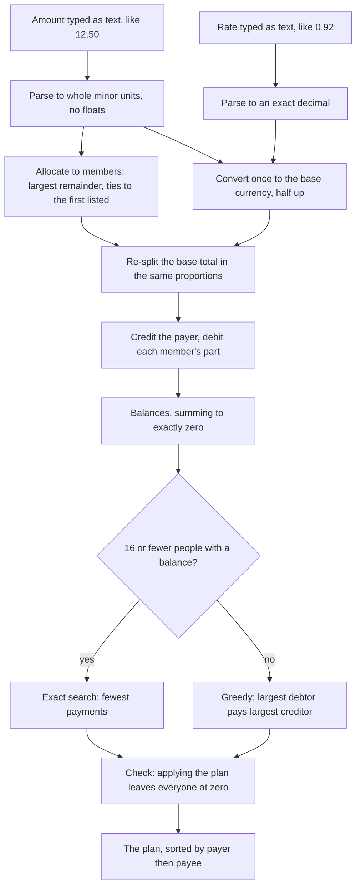

Every number Penny shows comes from one piece of code, the money engine in `@penny/core`. It works on whole numbers only. No amount ever passes through a floating-point number. In JavaScript's own arithmetic, 1.005 times 100 comes out as 100.49999999999999, and that kind of drift never reaches a balance. The browser runs the same engine to preview a split, so the preview and the saved result cannot disagree.

## The money path

An expense in the base currency skips the rate and the conversion. A rate on a base-currency expense is refused rather than ignored.

## The steps, with the Lisbon trip

The sample trip has seven expenses. The last one, the surf lesson, is the only one that uses every step, so it is the example here.

1. Parse the amount. The text "150.00" in US dollars becomes the whole number 15000, a count of cents. Text that does not mean exactly one such number is refused, never rounded: "12.505" in dollars, "1e3", "-5" and "1,5" are all errors. See [Exact to the cent](./exact-to-the-cent.mdx).
2. Allocate to members. The surf lesson is split equally between Ana and Cy, so each gets 7500 cents, which is 75.00 USD. When a split leaves a unit over, the largest remainder takes it, and a tie goes to whoever is listed first.
3. Parse the rate. The text "0.92" becomes an exact decimal: the whole number 92 with two digits after the point.
4. Convert once. 15000 cents at 0.92 is exactly 13800 euro cents, so the expense is worth 138.00 EUR. When a conversion is not exact, it rounds half up, once per expense. See [Currencies and rates](./currencies-and-rates.mdx).
5. Re-split the base total. The converted total, 13800, is split in the same proportions as the original parts. Equal parts of 7500 and 7500 give 6900 and 6900, so Ana and Cy are each charged 69.00 EUR. Splitting again, instead of converting each part on its own, is what keeps the parts adding up to the total.
6. Credit and debit. Cy paid, so Cy is credited 138.00 EUR. Ana and Cy are each debited 69.00 EUR. Net, Ana owes Cy 69.00 EUR for this expense.
7. Sum the balances. After all seven expenses, each person's balance is what they paid minus what they owe. The balances add up to exactly 0.00, always.
8. Count the people with a balance. Four people have a non-zero balance, which is 16 or fewer, so Penny runs the exact search for the fewest payments.
9. Check the plan. Before the plan is shown, Penny applies it to the balances and confirms everyone ends at exactly zero. A plan that fails the check is an error, not an answer.
10. Sort and show. The plan is listed by payer, then by payee. See [Settling up](./settling-up.mdx).

## All seven expenses

| Expense | Paid by | Amount | Split | Each part in EUR |
| --- | --- | --- | --- | --- |
| Flights | Ana | 480.00 EUR | Equally, all four | 120.00 each |
| Apartment | Ben | 360.00 EUR | Equally, all four | 90.00 each |
| Dinner at Taberna | Cy | 96.50 EUR | Equally, Ana, Ben and Cy | Ana 32.17, Ben 32.17, Cy 32.16 |
| Museum tickets | Dev | 54.00 EUR | Exact amounts, Ana, Ben and Dev | 18.00 each |
| Taxi from airport | Ana | 31.20 EUR | By shares, 2 for Ana, 1 for Ben, 1 for Cy | Ana 15.60, Ben 7.80, Cy 7.80 |
| Groceries | Dev | 42.75 EUR | Equally, all four | Ana 10.69, Ben 10.69, Cy 10.69, Dev 10.68 |
| Surf lesson | Cy | 150.00 USD at 0.92, which is 138.00 EUR | Equally, Ana and Cy | 69.00 each |

Each person's balance is what they paid, converted to euros, minus the sum of their parts.

| Person | Paid | Their parts add up to | Balance |
| --- | --- | --- | --- |
| Ana | 511.20 EUR (flights and taxi) | 355.46 EUR | owed 155.74 EUR |
| Ben | 360.00 EUR (apartment) | 278.66 EUR | owed 81.34 EUR |
| Cy | 234.50 EUR (dinner and the surf lesson at 138.00) | 329.65 EUR | owes 95.15 EUR |
| Dev | 96.75 EUR (museum and groceries) | 238.68 EUR | owes 141.93 EUR |

155.74 plus 81.34 is 237.08, and 95.15 plus 141.93 is 237.08. The total is 0.00 EUR. The plan is three payments: Cy pays Ana 13.81, Cy pays Ben 81.34 and Dev pays Ana 141.93.

## Refusals along the way

- A conversion that rounds to zero is refused with "That amount is too small to convert."
- A conversion that passes 10,000,000,000.00 in a two-decimal currency (10^12 minor units) is refused with "That amount is too large."
- A payment names the group version its plan line came from, so a payment pressed on an out-of-date page is refused rather than recorded twice. See [Settle up](../guides/settle-up.mdx).
