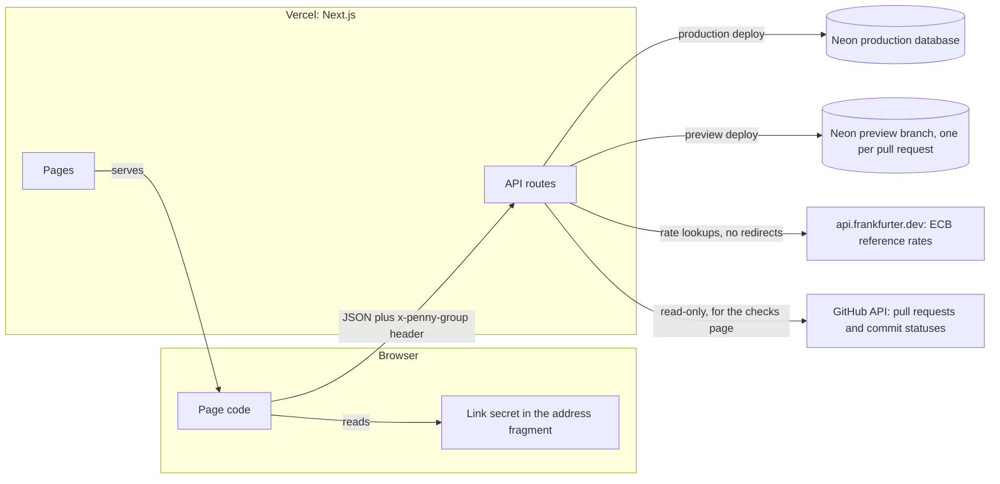

Penny is two packages in one repository. `@penny/core` is the money engine: pure functions on whole numbers, with no network and no database. `@penny/web` is a Next.js app that stores groups in Postgres and calls the engine for every amount it saves or shows. The browser runs the same engine to preview a split, so the preview and the saved result come from one piece of code.

## System

This diagram shows where each piece runs and which way data moves. The group link's secret stays in the address fragment after `#`, which browsers never send in a request, and the page copies it into a header for the API.

Notes that the picture leaves out:

- Every API route runs for at most 10 seconds, and every database statement has its own time limit.
- Rate limits are rows in Postgres, not memory, so they hold across serverless instances.
- The rate and the pull request list are cached in Postgres (`fx_cache`, `checks_snapshot`), so many visitors cost the upstream one call per window.
- Pages and routes send a content security policy, `Referrer-Policy: no-referrer` and `noindex` on group pages. The details are in the [threat model](https://github.com/ramakrishnanhulk20/penny/blob/main/docs/security/threat-model.md).

## How a request flows

Take "Add expense". The steps are the same for every write.

1. In the browser, the form parses the amount and the rate with the money engine and shows the preview. When you press the button, the page reads the secret from the address fragment and sends `POST /api/group/expenses` with the header `x-penny-group`, a JSON body and a fresh `clientId`.
2. The route handler first refuses any body that is not declared `application/json` (415). Then it counts the request against the per-network write limit (429 past it).
3. The body is read before a database connection is opened, up to 16 KiB, and checked against one exact schema that rejects unknown fields (400 with a short code).
4. One function turns the secret into a group. It checks the 22-character format, hashes the secret and looks the hash up. Anything that does not match is the same 404. Then the per-group write limit is counted.
5. In one transaction, the store locks the group row, looks for an earlier request with the same `clientId`, checks the size caps and that every member id belongs to the group, and runs the money engine on the amount, the rate and the split.
6. Still in that transaction, it writes the expense, its parts and an event to the log, and moves the group's `version` on. Writes to one group are serialised by the row lock, so two presses cannot race.
7. The handler builds the group view: balances, settle-up plan and lists, recomputed by the engine from the stored rows and checked so the balances sum to zero. It answers 201 with `{expense, group}`, or 200 with the original for a repeated `clientId` and body.

Errors carry only a short code, such as `{"error":{"code":"amount_zero"}}`. The browser maps each code to its own sentence. A server code is never shown as text. The [API page](./api.mdx) lists every route and code.

## Data model

All tables are in [packages/web/src/db/schema.ts](https://github.com/ramakrishnanhulk20/penny/blob/main/packages/web/src/db/schema.ts). The migrations are in [packages/web/drizzle](https://github.com/ramakrishnanhulk20/penny/tree/main/packages/web/drizzle), and the build stops if any of them was skipped.

| Table | What it holds |
| --- | --- |
| `groups` | One row per group: name, base currency, a `version` that moves on every ledger write, and `token_hash`, the SHA-256 of the link token. The token itself is never stored. |
| `members` | A group's people, in the order added. Removing a member sets `removed_at` and keeps their history. Live names are unique per group after Unicode normalisation and lower-casing. |
| `expenses` | One row per expense: amount in minor units, currency, an exact rate (`rate_units` and `rate_scale`), who paid, the split mode, a `version` for edits, `deleted_at`, and a `client_id` that is unique per group so a retry cannot add it twice. |
| `expense_parts` | One row per member in a split. The weight is 1 for an equal split, the share count for shares, and the minor units for exact amounts. |
| `payments` | One row per recorded payment: from, to, amount, currency, rate, `deleted_at` for an undo, and a `client_id` unique per group. |
| `events` | The append-only log of every change. Database triggers refuse any update, delete or truncate. Balances equal a replay of this log, and a test proves it after random operations. |
| `checks_snapshot` | A single row holding the last good read of GitHub for the checks page, shared by every instance. |
| `fx_cache` | The latest rate per currency pair, kept as the decimal text that was accepted. |
| `rate_limits` | One counter per bucket, key and one-minute window. The key is a group id or an HMAC of the client network, never an address. |
| `server_keys` | A single row holding the key those HMACs use. |

Every member reference is a composite key on group and member, so a row cannot name a member of another group. The database also repeats the app's bounds as `CHECK` constraints: three capital letters for a currency, amounts from 1 to 10^12, a positive rate with a scale of at most 10.

## The money engine

The engine in [packages/core/src](https://github.com/ramakrishnanhulk20/penny/tree/main/packages/core/src) is split by job.

| File | Job |
| --- | --- |
| `decimal.ts` | Reads and writes plain decimals, shared by amounts and rates. |
| `amount.ts` | Parses a typed amount into minor units and writes minor units back as text. |
| `rate.ts` | Parses a rate into an exact decimal and converts an amount once, half up. |
| `currency.ts` and `currencies.generated.ts` | The ISO 4217 table and its lookup. |
| `allocate.ts` | Splits a total by the largest remainder rule. |
| `ledger.ts` | Turns expenses and payments into base-currency balances. |
| `settle.ts` | Finds the fewest payments, exactly up to 16 people and greedily beyond, and checks the plan. |

[How it works](../concepts/how-it-works.mdx) walks through them in order.

## The invariants

The rules that bind the pieces together are numbered C1 to C42 in the [threat model](https://github.com/ramakrishnanhulk20/penny/blob/main/docs/security/threat-model.md). They fall into these groups:

| Group | Numbers | What they cover |
| --- | --- | --- |
| Tenancy and the link | C1 to C6 | One function turns a token into a group, 128-bit tokens, only a hash stored, no id outside the group is trusted, exact request schemas. |
| Money | C7 to C18 | One parser for amounts and rates, one currency table, splits that add up, balances that sum to zero, retry-safe writes, version checks, an append-only log. |
| Upstream calls | C19 to C24 | One fixed rate source with no redirects, a checks page that cannot be told a check passed by a look-alike. |
| Rendering, limits and errors | C25 to C28 | Text is only ever text, limits hold across instances, no test-only door in production, errors reveal nothing. |
| Build, preview and CI | C29 to C37 | Previews hold synthetic data, the self-fix agent holds no secret and cannot push, a person merges every robot fix. |
| Link reset | C38 | A lost answer never leaves a group without a working link. |
| Later additions | C39 to C42 | One press is one payment, migrations cannot be skipped, stored currency codes stay readable, the preview cleanup deletes only the closing pull request's own database branch. |

The [security overview](../security/overview.mdx) explains the main ones in plain words.
