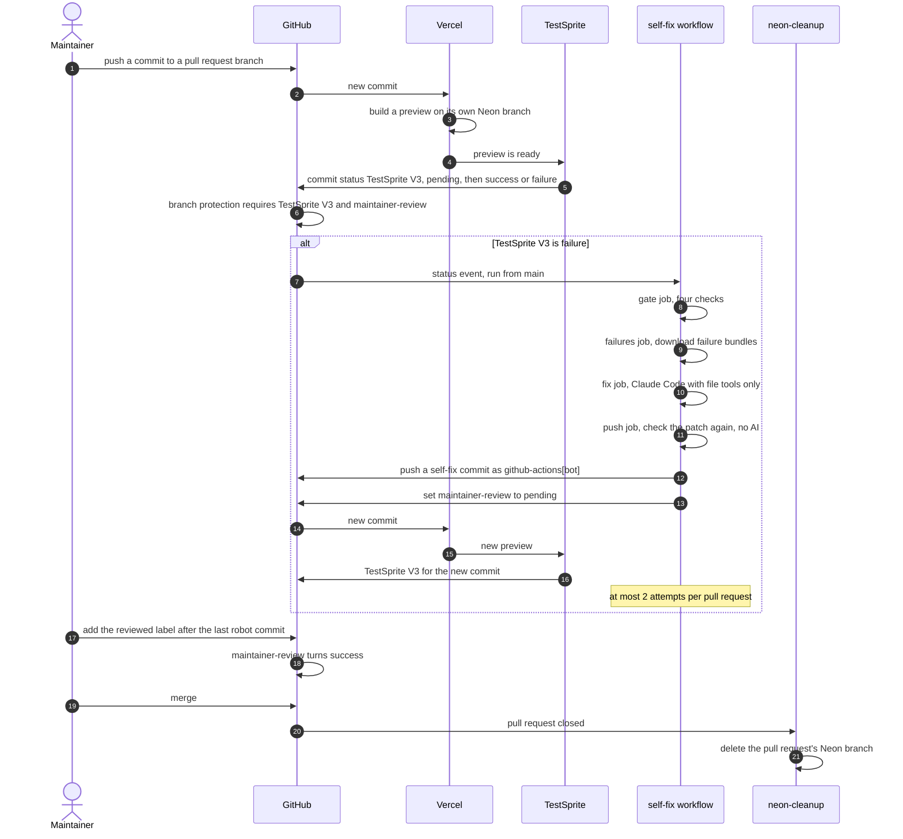

When TestSprite fails one of Penny's pull requests, GitHub runs Claude Code on the failure. A separate job with no AI in it checks the proposed change and pushes it to the pull request. Vercel redeploys the preview and TestSprite tests it again. No person is involved until the merge, and GitHub will not merge a pull request with a robot commit until the maintainer marks it reviewed.

## The red-then-green pull request

Pull request [#10](https://github.com/ramakrishnanhulk20/penny/pull/10) plants a one-line bug on purpose: the leftover cent of a split goes to the last person listed instead of the first. 100.00 split three ways comes out as 33.33, 33.33 and 33.34. All times are UTC, 20 October 2026.

| Time | What happened |
| --- | --- |
| 05:02 | The bug is pushed and the pull request opens. |
| 05:23 | Vercel's preview is live and TestSprite queues its 21 browser tests against it. |
| 05:27:08 | TestSprite finishes its 21 browser tests on that preview and posts `TestSprite V3: failure`, "18/21 passed, 3 failed". The branch rule requires that check, so GitHub will not merge. |
| 05:27:09 | The [self-fix run](https://github.com/ramakrishnanhulk20/penny/actions/runs/39374963904) starts. Four jobs: gate, failures, fix, push. Claude Code reads the failure details with file tools only: 8 turns, about 9 US cents. |
| 05:28:29 | The push job finishes, 81 seconds after the red. Its commit, from `github-actions[bot]`, changes one line in `packages/core/src/allocate.ts` and undoes the planted flip. |
| 05:31:52 | TestSprite tests the new preview: "All 21 tests passed". Red to green took 4 minutes 44 seconds, with no person involved. |
| 05:48:49 | The maintainer reads the one-line change and merges. |

The `maintainer-review` gate did not exist yet. It arrived in [pull request #11](https://github.com/ramakrishnanhulk20/penny/pull/11). From then on, a pull request that carries a robot commit also waits for the maintainer to add a `reviewed` label.

## The four jobs

Each run is four jobs in a row, and each job holds only what it needs.

| Job | What it does | AI | Secret |
| --- | --- | --- | --- |
| gate | Checks four conditions. If any fails, the run ends with "skipped: reason" and does nothing else. | No | None |
| failures | Lists the project's TestSprite tests and downloads the failure details of each test that is failing on this pull request's preview. | No | The TestSprite key, in one step only |
| fix | Checks out exactly the commit TestSprite tested and runs Claude Code on the failure details with file tools only: read, edit, write and search. No shell, no web. The edits become a patch that is checked before it can leave the job. | Yes | The Claude token, in the agent's step only |
| push | Checks the patch again, commits it as `github-actions[bot]` with a fixed message, pushes it only if the branch still points at the tested commit, comments on the pull request, and marks the new commit `maintainer-review: pending`. | No | None |

The four conditions in the gate are: the verdict is TestSprite's own, the pull request belongs to the maintainer and has not moved, fewer than two attempts have been made on this pull request, and fewer than six today. The rules are spelled out on [Self-fix safety](../security/self-fix-safety.mdx).

## The pull request loop

This diagram shows one pull request from push to merge, including the path where TestSprite fails and the self-fix workflow pushes a repair. The merge needs two commit statuses, `TestSprite V3` and `maintainer-review`, and GitHub enforces both.

- `maintainer-review` is success at once for a pull request with no robot commit. It stays pending on one with a robot commit until the maintainer adds the `reviewed` label after the last robot commit.
- `TestSprite V3` is pinned to TestSprite's GitHub App and `maintainer-review` to GitHub Actions in the branch rule, so a job that borrows a name cannot satisfy either check.

## The caps

- 2 self-fix attempts per pull request.
- 6 attempts per day across the repository.
- 1 run per tested commit at a time, and 1 agent per pull request at a time.
- 30 agent turns, 2 US dollars of model usage and 20 minutes per attempt.
- 200 changed lines per patch.
- 10 failure bundles per run.
- Failure bundles and patches are kept for 1 day.

An attempt counts as soon as its fix job starts, whatever happens next: a refused patch, an agent error or a cancelled run all count.

## The review gate

GitHub does not let the author of a pull request approve it, so the maintainer records a review with a label instead. A required status called `maintainer-review` holds the merge until the label is there. The workflow runs whenever a pull request is opened, reopened, pushed to, labeled or unlabeled, and posts the status on its head commit.

| The pull request | Status |
| --- | --- |
| Has no robot commit | success: "No robot commits on this pull request" |
| Has a robot commit, and the maintainer's `reviewed` label came after the last one | success: "Reviewed by Ram after the last robot commit" |
| Anything else | pending: "Waiting for Ram to review the robot's fix (add the reviewed label)" |

A second robot commit needs a fresh review: the maintainer removes `reviewed` and adds it again after reading the new change. The gate runs the default branch's copy of its script, so a pull request cannot change the rule it is judged by.

## What the loop does not do

The loop does not decide whether a fix is right. A green check means TestSprite's tests passed, nothing more. That is why a person reads every robot fix before it merges. The loop is also limited by design: two attempts per pull request, and a pull request that is still red after that waits for a person.

GitHub does not start other workflows for a push made with a workflow's own token, so the `ci` workflow (typecheck, lint, unit tests) does not run on a self-fix commit by itself. Closing and reopening the pull request runs it on the new head before the merge.

Everything the loop defends against, and the cases it does not, is on [Self-fix safety](../security/self-fix-safety.mdx).
